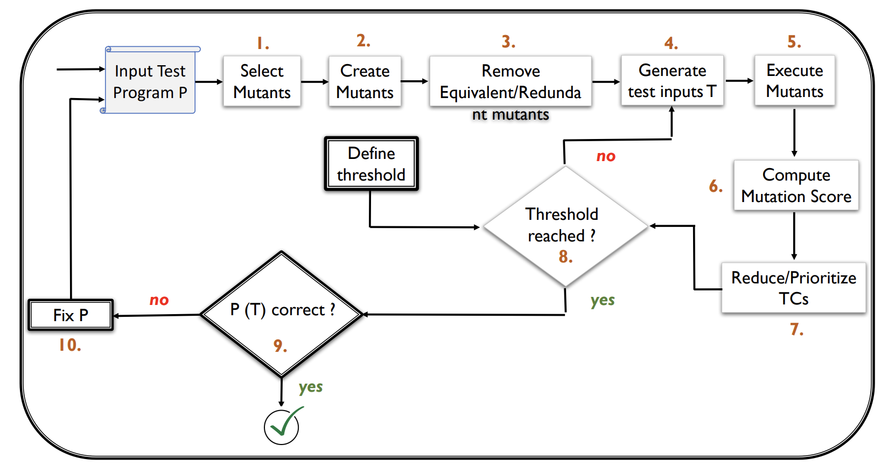

# INFORMATIONS GÉNÉRALES

- **Nom de l'article** : Mutation Testing Advances: An Analysis and Survey
- **Auteur** : Mike Papadakisa ,Marinos Kintisa ,Jie Zhangc ,Yue Jiab ,Yves Le Traona, Mark Harmanb
- **Date de publication** : 14-12-2016 
- **Lien** : [https://ieeexplore.ieee.org/abstract/document/5487526](https://ieeexplore.ieee.org/abstract/document/5487526)  
- **Analysé par** : Maël Angot

## 1 - Définition
Un mutant est un programme altéré par un défaut volontaire sur une opération arbitraire du programme.

## 2 - Mort d’un mutant
Un mutant peut être **faiblement tué** lorsque les répercussions de son défaut n'apparaissent pas explicitement mais modifient l'état interne du programme.  
Un mutant est **fortement tué** quand on peut voir directement qu’il y a eu une erreur.

## 3 - Score de mutation
L'utilisation du mutation score comme mesure d'adéquation suppose que tous les mutants ont la même valeur, ce qui est faux. Certains mutants sont équivalents ou redondants :

- **Mutants équivalents** : Fonctionnellement identiques au programme original.
- **Mutants redondants** : Tués en même temps que d'autres mutants.  

### Types de mutants redondants :
- **Duplicata** : Mutants équivalents entre eux mais pas au programme original.
- **Mutants subsumés** : Tués automatiquement lorsque d'autres mutants sont tués.

Ces mutants gonflent artificiellement le mutation score, rendant la mesure difficile à interpréter. Cependant, identifier les équivalences et redondances est un **problème indécidable**.

## Défis et pistes à creuser 

- Minimiser le nombres de mutants redondants ou équivalents. Des techniques existent déjà (voir [Élimination des mutants équivalents et redondants](#élimination-des-mutants-équivalents-et-redondants)
)

- Détecter les mutants faiblement tués (en augmentant la qualité des tests)

---

# Processus de Mutation Testing

## 1 - Sélection des mutants

La sélection des mutants est une étape essentielle du mutation testing. Elle nécessite de définir **un ensemble d’opérateurs de mutation** qui vont introduire les mutants via des transformations syntaxiques spécifiques. Cependant, cette analyse du langage ciblé peut produire un nombre énorme de mutants. Il est donc crucial de sélectionner des sous-ensembles représentatifs pour limiter les coûts du processus.

### Mutant Operators

Les opérateurs de mutation sont conçus pour différents langages, catégories d’applications, types de bugs et éléments de programmation. Voici les principales catégories :

#### 1. **Opérateurs pour des langages spécifiques**
   - **AspectJ** : Anbalagan et Xie introduisent deux opérateurs — renforcement et affaiblissement de pointcut.  
   - **C#** : Derezinska et Kowalski proposent six opérateurs pour le code intermédiaire C#.  
   - **WS-BPEL** : Estero-Botaro définit 26 opérateurs pour WS-BPEL.  
   - **JavaScript** : Mirshokraie propose des opérateurs ciblant les erreurs courantes, comme la suppression du mot-clé `this`.  
   - **C++** : Delgado-Pérez développe un outil de mutation MuCPP utilisant l’arbre syntaxique de Clang.

#### 2. **Opérateurs pour des catégories de langages**
   - **Langages orientés objet** : Derezinska conçoit des opérateurs spécifiques aux défauts orientés objet.  
   - **Langages dynamiques** : Bottaci préconise d’éviter les mutations faciles à tuer liées aux types, et Gligoric propose SMutant, un outil pour tester les mutations dynamiques.  

#### 3. **Opérateurs pour des applications spécifiques**
   - **Android** : Deng et Linares-Vasquez définissent des opérateurs pour les cycles de vie d’activité et les événements.  
   - **Applications web** : Praphamontripong et Offutt affinent les opérateurs pour les applications web.  
   - **GUI** : Oliveira propose des opérateurs au niveau de l’interface utilisateur.  

#### 4. **Opérateurs pour des catégories de bugs spécifiques**
   - **Sécurité** : Loise propose 15 opérateurs liés aux problèmes de sécurité.  
   - **Défauts mémoire** : Nanavati définit 9 opérateurs ciblant les erreurs mémoire.  
   - **Interactions de fonctionnalités** : Garvin et Cohen introduisent des mutants basés sur les résultats de deux projets open-source.

D’autres opérateurs visent les annotations de type (Gopinath et Walkingshaw), les tests paramétrés (Xie), ou les expressions régulières (Arcaini).

---

### Mutant Reduction Strategies

Les stratégies de réduction des mutants visent à sélectionner des sous-ensembles représentatifs pour réduire les coûts de mutation testing.

#### 1. **Sélection aléatoire**
   - Papadakis et Malevris montrent que sélectionner aléatoirement des sous-ensembles de mutants entraîne une perte de détection de défauts modérée.  

| Pourcentage de mutants sélectionnés | Perte de détection des fautes (%) |
|-------------------------------------|-----------------------------------|
| 10%                                 | 26%                              |
| 20%                                 | 16%                              |
| 30%                                 | 13%                              |
| 40%                                 | 10%                              |
| 50%                                 | 7%                               |
| 60%                                 | 6%                               |

   - Zhang et son groupe a montré qu'en tuant la moitié des mutants selectionnés au hasard revient à tuer 99% de tous les mutants.

#### 2. **Sélection basée sur les types de mutants**
   - Namin utilise une analyse statistique pour identifier les opérateurs les plus prédictifs du score de mutation. En n'utilisant uniquement ces types de mutants, on parvient à obtenir un score de mutation très précis en se passant de **93% des mutants total**.
   - **Les opérations de suppression** et certaines autres mutations (comme les opérateurs relationnels) sont identifiées comme étant particulièrement **coût-efficaces** car elles produisent moins de mutants équivalents, ce qui simplifie l’analyse.
   - Des stratégies plus avancées combinent des méthodes de clustering, de filtrage dynamique et des mesures de similarité pour sélectionner les mutants les plus représentatifs.

#### Résumé et pistes à creuser
- **Sélection aléatoire vs mutation sélective** : Peu de différences significatives entre les deux méthodes, mais des améliorations possibles de l'ordre de 13% avec la mutation sélective.
- **Mutants d'ordre supérieur** : Une méthode prometteuse avec des réductions substantielles des mutants (jusqu'à 80-90%), mais avec une certaine perte d'efficacité dans les tests.
- **Localisation des mutants** : Une approche où la position dans le code ou les chemins du programme est utilisée pour sélectionner les mutants les plus importants.
- **Priorisation par difficulté** : Sélectionner les mutants les plus difficiles à tuer pour maximiser l’efficacité des tests.

## 2 - Création des Mutants

Une fois que les mutants ont été sélectionnés, la prochaine étape consiste à **générer les fichiers sources pour chaque mutant**. Cela signifie qu'un nouveau fichier source est créé pour chaque mutation envisagée, contenant le code avec les modifications appliquées. Une technique couteuse en ressource et en temps. **3 secondes sont nécessaires pour compiler chaque mutant**

Pour gérer cette inefficacité, des techniques visant à **réduire le coût de la création des mutants** tout en maintenant leur efficacité pour les tests ont été imaginées.

### Techniques de création :
1. **Fichiers sources séparés** : Coûteux en temps pour des projets volumineux.
2. **Méta-mutation (schémas de mutants)** : Paramétrage des mutants dans un fichier unique.
3. **Manipulation de bytecode** : Modification directe du bytecode (Java, .NET).
4. **Systèmes interprétés** : Utilisation de machines virtuelles pour introduire et contrôler les mutants.
5. **Lignes de produit** : Les mutants sont traités comme des "features" d’un système. Supposons qu’on teste un programme avec trois mutants possibles : M1, M2, et M3. Dans une approche classique, on créerait 3 programmes mutants séparés.
Avec l’approche de ligne de produits, on garde un seul programme avec des options pour activer ou désactiver M1, M2, et M3 selon les besoins.  
En pratique :
L’utilisation de lignes de produits pour les tests de mutation est une approche plus efficace et modulaire, surtout lorsqu’on travaille avec un grand nombre de mutants. Cela permet aussi de mieux intégrer les tests dans les pipelines de développement modernes.

---

## 3 - Élimination des mutants équivalents et redondants
L'objectif est d'identifier et d'éliminer les mutants inutiles avant leur exécution.

### Mutants équivalents
Ces mutants sont sémantiquement identiques au programme d'origine. Leur détection est complexe, mais des **heuristiques** sont utilisées :
- **Optimisation triviale du compilateur (TCE)** : Compare le code objet des mutants pour détecter les équivalences. (Détecte 30% des mutants équivalents (résultats empiriques))
- **Analyse de flux de données** : Identifie les anomalies dans les modèles de flux.
- **Exécution symbolique** : Détecte les mutants "tuables" à partir de données symboliques.
- **Clones logiciels** : Utilise les similitudes entre clones pour projeter les mutants équivalents.

### Mutants redondants
Ces mutants faussent les résultats. Approches pour les réduire :
- Restreindre les conditions de test pour certains opérateurs.
- **Règles d’élimination** : 37 règles réduisent en moyenne 13 % des mutants.
- **TCE pour redondance** : Compare le code objet pour éliminer les duplications.
- **Exécution symbolique différentielle** : Identifie les redondances par comparaison symbolique.

---

## 4 - Génération des données de tests

### 1. Static Constraint-Based Test Generation
#### Principe :
Les conditions **RIPR** (Reachability, Infection, Propagation, Revealability) sont transformées en contraintes, résolues à l’aide de solveurs.

#### Exemples :
- **Wotawa et al.** : Formulation des programmes originaux et mutants comme des systèmes de contraintes.
- **Symbolic Execution** : Sélection de chemins pertinents pour simplifier la résolution.
- **Bounded Model Checking** : Techniques de vérification bornée.

#### Limitation :
Les chemins sélectionnés peuvent être non exécutables, nécessitant des stratégies heuristiques.

---

### 2. Concolic/Dynamic Symbolic Execution Test Generation
#### Principe :
Utilisation de l’exécution réelle pour générer des contraintes symboliques. Les conditions d’infection des mutants sont intégrées dans le programme. Cette technique évite les exécution concrêtes avec des valeurs symboliques donc plus larges (x=X et non x=4 par exemple).

#### Exemples :
- **Papadakis et al.** : Encodage des mutants et génération de tests ciblés.
- **Zhang et al.** : Utilisation d'annotations pour guider la génération de tests.

#### Limitation :
Les tests générés tuent souvent des mutants triviaux.

---

### 3. Search-Based Test Generation
#### Principe :
Utilisation d’algorithmes comme le **hill climbing** ou les **algorithmes génétiques** pour explorer les entrées du programme. Les noeuds peuvent être vus comme un état de programme, les arêtes comme des transitions.

#### Exemples :
- **Papadakis et al.** : Fonction d’adéquation mesurant la distance pour infecter les mutants.
- **Fraser et Zeller** : Approximations des conditions de propagation.
- **Patrick et al.** : Évolution des sous-domaines d'entrées.

#### Limitation :
Les conditions de propagation sont souvent indirectes rendant difficile la traçabilité des changements. Des valeurs modifiées peuvent être utilisés à plusieurs endroits par exemple.

---

## 5 - Exécution
### Problèmes clés :
- **Coût de l'exécution** : Chaque test doit être exécuté pour tous les mutants, entraînant des coûts élevés.
- **Limites de scalabilité** : Nombre élevé d’exécutions pour tester tous les mutants.

### Scénarios et Optimisations :
#### Scénario A : Calcul du score de mutation
Un mutant n’a besoin d’être exécuté que jusqu’à ce qu’il soit tué.

#### Scénario B : Calcul d’une matrice de mutants
Chaque mutant doit être exécuté avec chaque test, sans possibilité d’optimisation.

#### Optimisations proposées :
1. **Réduction du nombre d’exécutions** :
   - Priorisation des tests les plus rapides ou les plus probables de tuer des mutants.
   - Exclusion des mutants non accessibles.
2. **Exécution partagée** : Exploitation des parties communes entre le programme original et les mutants.
3. **Exécution parallèle** : Répartition sur plusieurs nœuds pour réduire le temps global de test.

## 7 - Réduction et Priorisation des Cas de Test

### 1. Réduction de la Suite de Tests (Test Suite Reduction)
La **réduction** des suites de tests consiste à supprimer des cas de test **redondants** sans affecter la mutation score (capacité à détecter des défauts).

- **Méthode de réduction** : 
  - Usaola et al. ont proposé un **algorithme glouton** qui sélectionne les tests tuant le plus grand nombre de mutants non tués par les tests précédemment sélectionnés.
  
- **Estimation de la perte de détection des défauts** : 
  - Hao et al. utilisent la **mutation** pour estimer la perte de détection des défauts après réduction de la suite de tests. Cela permet de minimiser la suite de tests tout en estimant la perte de capacité de détection.
  
- **Simplification des tests** :
  - Alipour et al. ont proposé de **simplifier les tests individuels** plutôt que de les supprimer, en mesurant les compromis entre simplification et perte de détection des défauts.

### 2. Priorisation des Cas de Test (Test Suite Prioritisation)
La **priorisation** consiste à organiser les tests de manière à tuer les mutants le plus tôt possible, afin d'optimiser la détection des défauts.

- **Priorisation basée sur le nombre de mutants tués** :
  - Lou et al. ont trouvé que la priorisation **par le nombre de mutants tués** est la plus efficace.
  
- **Ordonnancement des tests** :
  - Nguyen et al. ont proposé d'exécuter d'abord les tests qui tuent le **plus grand nombre de mutants**, ce qui est particulièrement utile dans des contextes comme l'audit des services web. Seulement les mutants qui ne violent pas l'**explicit contract** sont pris en compte.

### Conclusion
La réduction des suites de tests permet de **supprimer les tests redondants** tout en maintenant une bonne capacité de détection des défauts, tandis que la priorisation permet de **maximiser l'efficacité des tests** en tuant les mutants dès que possible. Ces deux stratégies peuvent être combinées pour optimiser les suites de tests en termes de coûts et d'efficacité.

## 8 - Confiance Inspirée par le Score de Mutation

Le processus de test de mutation s'arrête lorsque le **score de mutation** atteint un seuil spécifié par l'utilisateur, censé refléter la **confiance** des développeurs dans les tests réalisés. Toutefois, peu d'études abordent la relation entre ce score et la **révélation de défauts**. 

### Résultats Clés des Études
- **Li et al.** ont montré que les suites de tests adéquates en mutation (celles qui tuent tous les mutants tuables) révèlent **plus de défauts** que celles basées sur des critères de tests structurels.
- **Papadakis et al.** et **Chekam et al.** ont observé que la relation entre un score de mutation élevé et la révélation de défauts suit un comportement de seuil : au-delà d'un certain score, le score de mutation est fortement lié à la détection de défauts. En dessous de ce seuil, le score de mutation est déconnecté de la révélation de défauts.
- Les tests **forts** (avec un score de mutation élevé) sont capables de révéler au moins **90% des défauts** d'un programme.

### Problèmes liés aux Mutants Équivalents et Redondants
Les mutants équivalents et redondants compliquent l'évaluation exacte du score de mutation, entraînant des **surestimations ou sous-estimations** du score réel. Les mutants équivalents, en particulier, tendent à réduire le score, tandis que les mutants redondants ont des effets mixtes.

### Conclusion
Bien que des études suggèrent que le score de mutation est un bon indicateur de la qualité des tests, il reste peu de recherche sur cette relation et sur les problèmes associés aux mutants équivalents et redondants. Ces domaines devraient faire l'objet de futures recherches afin de mieux comprendre la **confiance inspirée par le score de mutation** dans les processus de test.

## 9 - Oracles de Test

Une fois que les entrées de test sont créées et que le score de mutation souhaité est atteint, il est nécessaire de vérifier que le programme testé se comporte comme prévu. Cela implique l'utilisation d'**oracles de test** pour valider le comportement attendu du programme. Sans spécifications formelles, cette tâche est réalisée manuellement.

### Automatisation de la Création d'Oracles de Test
L'un des premiers efforts pour automatiser ce processus a été effectué par **Fraser et Zeller**, qui ont utilisé les mutants pour guider la création d'assertions d'oracle. Leur méthode consiste à vérifier (et à affirmer) la partie du programme responsable de la tuerie des mutants. Cela est formulé comme un problème de recherche, avec une approche automatisée pour générer des assertions de test que les testeurs doivent valider.

### Applications et Extensions
- Cette méthode a été étendue pour identifier des **pré-conditions et post-conditions** pertinentes pour des tests paramétrés.
- **Evosuite** utilise cette approche pour générer des oracles de test pour les programmes Java.
- **Yoshida et al.** ont appliqué une méthode similaire pour le **génération de tests** pour les programmes C/C++.
- **Jahangirova et al.** utilisent les mutants pour détecter les différences d'état observées et les abstraire sous forme d'oracles de test.

### Utilisation des Mutants pour la Création de Données d'Oracle
Les mutants ont également été utilisés pour générer des **données d'oracle** (ensemble de variables à surveiller pendant les tests). Cela implique de surveiller et de classer les variables internes du programme selon leur capacité à tuer des mutants. De plus, les mutants aident à **minimiser** les données d'oracle. 

### Conclusion
Les mutants sont largement utilisés pour créer et améliorer des oracles de test, en particulier dans les outils de génération de tests automatisés. Des recherches supplémentaires, comme celles de **Barr et al.**, explorent davantage la création et l'amélioration des oracles de test.

## 10 - Debugging

La recherche sur le **debugging** basé sur la mutation suit principalement deux directions : la **localisation des fautes** et la **réparation des fautes**.

### Localisation des Fautes Basée sur la Mutation
La localisation des fautes basée sur la mutation a été introduite par **Papadakis et Le Traon** avec la méthode **Metallaxis**. L'idée principale est que les mutants tués principalement par des tests échoués sont en interaction avec les défauts du programme qui ont causé les échecs. Ces mutants fournissent donc des indications sur les endroits défectueux du programme.

- **Résultats empiriques** ont montré que cette approche est supérieure aux techniques classiques de localisation des fautes, comme la localisation des fautes basée sur le spectre.
- **Metallaxis** a été étendu pour inclure des techniques de réduction de mutants, comme la mutation sélective, et a été libéré sous forme d'outil automatisé, **Proteum/FL**.
- **MUSE**, une méthode dérivée de Metallaxis, se distingue en vérifiant si les mutants transforment les cas de test échoués en cas réussis, sans se concentrer sur ceux qui sont tués par les tests échoués.
  
D'autres techniques de localisation des fautes basée sur la mutation incluent les travaux de **Zhang et al.**, **Hong et al.**, et **Murtaza et al.**, qui ont montré que ces méthodes identifient efficacement les lignes de code les plus suspectes.

### Réparation des Fautes Basée sur la Mutation et Autres Activités de Debugging
La mutation est également utilisée pour soutenir la réparation des programmes. Les travaux de **Debroy et Wong** ont observé que de nombreuses fautes sont corrigées par des transformations syntaxiques simples, ce qui permet aux mutants de servir de candidats potentiels pour des patchs. Cette technique est simple et peut être automatisée par un outil de test de mutation.

#### Réparation Automatisée des Fautes
La réparation des fautes automatisée est un domaine de recherche large. De nombreuses approches utilisent la **programmation génétique** ou des techniques basées sur des contraintes pour rechercher et vérifier des mutants capables de corriger les fautes. Les travaux de **Weimer et al.** ont utilisé la programmation génétique avec des opérateurs de mutation tels que la suppression de déclarations, l'insertion de déclarations, et le remplacement de déclarations pour soutenir la correction automatique des bugs. Ces approches se sont révélées particulièrement efficaces.

D'autres techniques de réparation, comme celles de **Tan et Roychoudhury**, utilisent la recherche de mutants pour réparer les fautes de régression. Des approches qui combinent des transformations syntaxiques spécialisées sont également utilisées pour effectuer la réparation des programmes.

#### Debugging Angélique
Le **debugging angélique** est une technique basée sur la mutation qui consiste à appliquer une forme de mutation d'état des données pour corriger l'exécution du programme. L'idée est d'identifier les valeurs pouvant remplacer l'état du programme à l'exécution pour obtenir une exécution "correcte".

### Conclusion
Les techniques de **localisation des fautes** et de **réparation des fautes** basées sur la mutation, ainsi que des approches comme le debugging angélique, jouent un rôle essentiel dans l'automatisation du processus de debugging, en rendant la détection et la correction des fautes plus efficaces.

